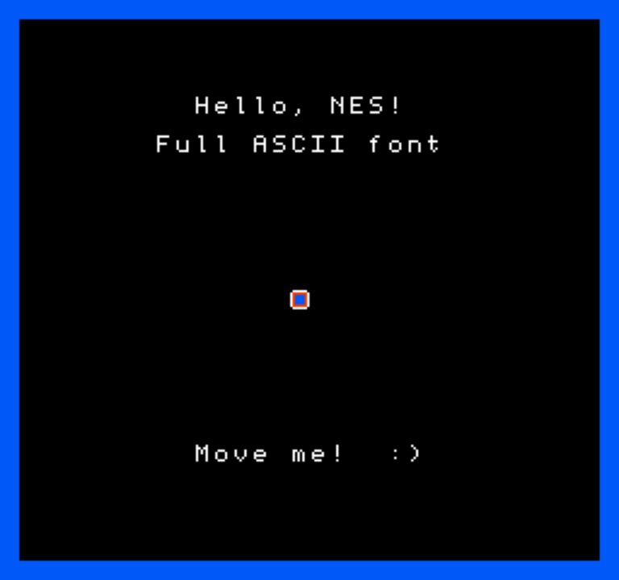
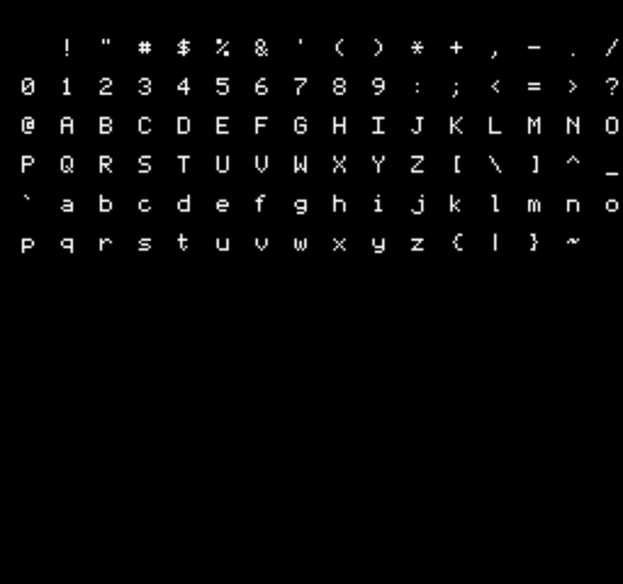

# NesRuntime

Write Nintendo Entertainment System games in **C#** and run them against a modern GUI
(MAUI or any other host) — without ever touching 6502 assembly or hardware registers.

NesRuntime is a **runtime**, not an emulator. You don't load a pre-built `.nes` ROM and
interpret its opcodes; you write your game logic in C# against a friendly SDK, and the runtime
maps it onto a hardware-faithful model of the NES. Everything you author is still bounded by the
**real limits of the console** — 64 sprites, 8 per scanline, four background + four sprite
palettes of three colors each drawn from the fixed 64-color system palette, a 256×240 tile grid,
and exactly five audio channels — so what you build looks and sounds authentically like an NES
game.

> Status: **API skeleton with working render + audio slices.** The full surface is present and
> documented. Two vertical slices are implemented end-to-end: (1) the PPU compositor (background
> tiles, palettes, 64 sprites with flipping/priority and the 8-per-scanline limit) with the real
> 64-color master palette, and (2) a software audio synthesizer (pulse/triangle/noise + one-shot
> sound effects) pumped through the frame loop to the host and played on Mac Catalyst. So a game
> renders real frames **and makes sound** on the MAUI host. The register-accurate APU/PPU,
> cartridge/mapper, and CPU-bus paths remain stubs.

## Solution layout

```
NesRuntime.slnx
 src/
   NesRuntime.Core/        Hardware-faithful model — the "what the NES can do" layer
   NesRuntime.Rendering/   Backend abstraction — decouples the runtime from any host
   NesRuntime.Sdk/         Game-author-facing API — the "how you write a game" layer
 hosts/
   NesRuntime.Maui/        .NET MAUI presentation host (SkiaSharp canvas + on-screen controls)
```

Dependency direction: `Sdk → Rendering → Core`, and a host depends on all three. Game code depends
only on **`NesRuntime.Sdk`**; a presentation host implements the **`NesRuntime.Rendering`**
backends and drives the loop. `NesRuntime.Maui` is the first such host.

### `NesRuntime.Core` — the hardware model

An authentic model of the console's subsystems. Game authors never reference this directly; the
SDK is built on it and it defines the constraints the SDK enforces.

| Area | Key types |
|------|-----------|
| Console / timing | `NesConsole`, `Region`, `ConsoleTiming`, `NesHardware` (limit constants) |
| CPU (2A03 core) | `Cpu2A03`, `InterruptSource` — interrupt lines & cycle accounting, **not** an opcode interpreter |
| Memory | `MemoryBus`, `IMemoryRegion`, `AddressRange`, `InternalRam` |
| PPU (2C02) | `Ppu2C02`, `PatternTable`/`Tile`, `Nametable`/`AttributeTable`, `ObjectAttributeMemory`, `PaletteMemory`, `MasterPalette`, `NesColor`, `MirroringMode`, `ScrollState`, `PpuControl`/`PpuMask`/`PpuStatus` |
| APU | `Apu2A03`, `PulseChannel`, `TriangleChannel`, `NoiseChannel`, `DmcChannel`, `FrameCounter`, `Envelope`/`SweepUnit`/`LengthCounter` |
| Input | `ControllerPort`, `StandardController`, `Zapper`, `FourScore`, `ExpansionPort`, `NesButtons` |
| Cartridge | `Cartridge`, `INesHeader`, `IMapper`, `MapperRegistry`, `PrgRom`, `ChrMemory`, `BatteryBackedRam` |
| DMA | `OamDmaUnit` |

### `NesRuntime.Rendering` — the host seam

Interfaces a presentation host implements so the runtime can drive it: `IVideoBackend`,
`IAudioBackend`, `IInputBackend`, `IFrameClock`, plus the `FrameBuffer` (256×240 palette indices)
and `RuntimeHost`, which binds a `NesConsole` to the four backends and runs the frame loop.

### `NesRuntime.Sdk` — what you write games against

| Area | Key types |
|------|-----------|
| Game | `NesGame` (base class: `Load`/`Update`/`Render`/`Unload`), `GameInfo`, `GameRunner` |
| Graphics | `IGraphicsDevice`, `ITileSet`/`TileHandle`, `IPaletteSet`/`SystemColors`, `IBackgroundLayer`, `ISpriteLayer`/`SpriteDraw`, `Camera` |
| Audio | `IAudioDevice`, `IToneVoice`/`INoiseVoice`/`ISampleVoice`, `Note`, `IMusicPlayer`/`MusicTrack`, `SoundEffect`/`SampleClip` |
| Input | `IInputManager`, `GamePad` (with `WasPressed`/`IsDown`/`WasReleased`), `Button`, `Pointer` |
| Storage | `ISaveManager` — battery-backed saves |
| Content | `IContentPipeline` (PNG→tiles, WAV→samples) and `INativeContent` (CHR, NSF, iNES ingest) |

Content authoring is **dual-path**: high-level imports (a PNG becomes tiles + a quantized NES
palette; a WAV becomes a DMC sample) *and* native NES formats (raw CHR pattern tables, NSF songs,
complete iNES cartridges), both producing the same runtime objects.

## What a game looks like

```csharp
using NesRuntime.Sdk.Game;
using NesRuntime.Sdk.Graphics;
using NesRuntime.Sdk.Input;

public sealed class HelloNes : NesGame
{
    private TileHandle _hero;
    private int _x, _y;

    public override GameInfo Info => new() { Title = "Hello NES", Author = "you" };

    protected override void Load()
    {
        Graphics.Palettes.SetSprite(0, SystemColors.White, SystemColors.Red, SystemColors.Black);
        _hero = Graphics.Tiles["hero"];   // added via the content pipeline
    }

    protected override void Update()
    {
        var pad = Input.GetPad(0);
        if (pad.IsDown(Button.Right)) _x++;
        if (pad.IsDown(Button.Left))  _x--;
    }

    protected override void Render()
    {
        Graphics.Sprites.Draw(new SpriteDraw(_x, _y, _hero, PaletteIndex: 0));
    }
}
```

A host launches it with `GameRunner.Create<HelloNes>(video, audio, input, clock)`, which returns a
`RuntimeHost` to `Run()`.

## The MAUI host

`hosts/NesRuntime.Maui` is a .NET MAUI app that implements the four `NesRuntime.Rendering`
backends and drives a game:

| Backend | Implementation |
|---------|----------------|
| `IVideoBackend` | `MauiVideoBackend` → `NesGameView`, an `SKCanvasView` that blits the 256×240 framebuffer with nearest-neighbor scaling |
| `IAudioBackend` | `MauiAudioBackend` → plays the synthesized samples via `AVAudioEngine` on Mac Catalyst (a ring buffer feeds an `AVAudioSourceNode`); no-op sink on platforms not yet wired |
| `IInputBackend` | `MauiInputBackend`, fed by an on-screen D-pad + A/B/Select/Start |
| `IFrameClock` | `DispatcherFrameClock`, ticking the loop on the MAUI UI dispatcher at the NTSC rate |

`MainPage` wires these to `HelloNesGame` via `GameRunner` and runs the loop. **Pressing Start
renders and plays sound**: the sample game draws a background border and bitmap-font text, plays an
intro jingle plus a blip when the hero bumps a wall, and moves a hero sprite with the on-screen
D-pad. Here is a frame captured straight from the runtime's framebuffer (3× nearest-neighbor):



The sample game ships an 8×8 bitmap font covering every printable ASCII character (0x20–0x7E):



It targets the desktop platforms: **Mac Catalyst** (built on macOS) and **Windows** (built on
Windows). Each OS builds only the target it can produce, so the solution builds cleanly in Rider or
`dotnet` on either without extra SDKs. **Mac Catalyst builds clean and runs on macOS today.** To
add mobile back, re-add `net10.0-android` / `net10.0-ios` to the host's `<TargetFrameworks>` once
the Android SDK and Xcode's iOS simulator runtimes are installed.

## Build

```sh
# SDK class libraries (no workload needed):
dotnet build src/NesRuntime.Sdk/NesRuntime.Sdk.csproj

# The MAUI host needs the MAUI workload (install once; root-owned SDK path → sudo):
sudo dotnet workload install maui

# The whole solution builds cleanly on macOS (host resolves to Mac Catalyst) or Windows:
dotnet build NesRuntime.slnx
```

Requires the **.NET 10 SDK** plus the **MAUI workload** for the host; the three libraries build
without the workload. On macOS the host builds Mac Catalyst; on Windows it builds the Windows
target — so `dotnet build NesRuntime.slnx` (and Rider's solution build) succeeds on either.

## Design decisions

- **Strict-authentic fidelity.** The API models and enforces real NES hardware limits; a game
  cannot exceed what the console could produce.
- **Namespace / product:** `NesRuntime`.
- **Target framework:** libraries `net10.0`; MAUI host `net10.0-maccatalyst` (macOS) / `net10.0-windows` (Windows).
- **Regions:** NTSC (default), PAL, and Dendy are all modeled via `ConsoleTiming`.

## Roadmap

The PPU render and audio slices are in. Next: make the APU register-accurate (replace the stand-in
synthesizer), implement scrolling/mid-frame split rendering, add native content import (PNG→tiles,
CHR/NSF/iNES loaders), wire audio output on Windows, and stand up a test project around the
compositor and synth.
